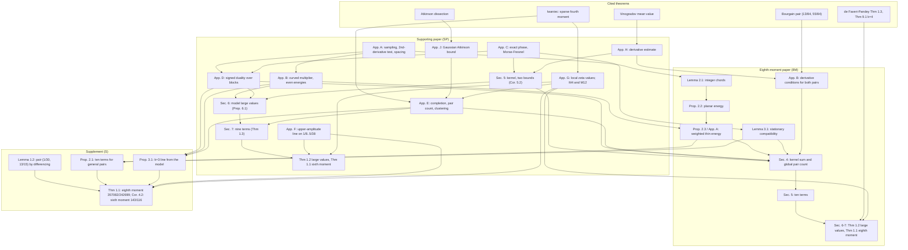

# Thin planar energy and the sixth and eighth moments of the Riemann zeta function

Min Chae. Preprints, 17 November 2026.

This repository contains two papers, a supplement, a two-page summary, and
exact-arithmetic checks.

| Result | Exponent | Decimal | Where | Cited theorems it rests on |
|---|---|---|---|---|
| $\int_0^T \lvert\zeta(\tfrac12+it)\rvert^8\,dt \ll T^{p_8+\varepsilon}$ | $76024973/51678924$ | 1.4711021 | Eighth-moment paper, Theorem 1.1 | sparse fourth moment; Vinogradov mean value; Bourgain's exponent pair; de Faveri–Pandey Theorems 1.3 and 9.1 (case $k=4$) |
| $\int_0^T \lvert\zeta(\tfrac12+it)\rvert^6\,dt \ll T^{p_6+\varepsilon}$ | $84599/68640$ | 1.2325029 | Supporting paper, Theorem 1.1 | sparse fourth moment; Vinogradov mean value |
| Eighth moment, fewer cited theorems | $357082/242699$ | 1.4712957 | Supplement, Theorem 1.1 | sparse fourth moment |
| Sixth moment, fewer cited theorems | $143/116$ | 1.2327586 | Supplement, Corollary 4.2 | sparse fourth moment |

All four start from Atkinson's dissection of $\zeta(u)\zeta(v)$.

## How these compare with earlier bounds

| Moment | Earlier bound | Source | Gain here |
|---|---|---|---|
| 8th | $3/2$ | classical (fourth and twelfth moments) | 0.02890 |
| 8th | $988/671 = 1.47243$ | follows from de Faveri–Pandey, Theorems 1.3 and 9.1 | 0.00133 |
| 8th | $346/235 = 1.47234$ | de Faveri–Pandey Theorem 9.1 ($k=3$) combined with Paper 38, Theorem 6 | 0.00124 |
| 8th | $118757448/80721773 = 1.47119$ | this paper's exponents with the ordinary curvature term in place of the thin terms | 0.00009 |
| 6th | $5/4$ | classical | 0.01750 |
| 6th | $37/30 = 1.23333$ | de Faveri–Pandey | 0.00083 |
| 6th | $12867/10438 = 1.23271$ | bramble_trace, rStation Paper 38 v3 | 0.00020 |

De Faveri and Pandey prove a saving $\delta_k>0$ for every $4<k\le12$ (their
Theorem 1.2). Paper 38 states moment bounds of orders 4 through 7. The values
$988/671$ and $346/235$ are our computation: they are what the large-value
theorems of those papers give when summed over amplitudes.

The fourth row isolates the thin energy. With the same two exponent pairs and the same
upper-amplitude line, the thin terms save 0.0000927. The rest of the gain over $346/235$
comes from the weighted pair energy, the two exponent pairs and the $k=4$ line.

Sources and versions are listed in [docs/RECORD_COMPARISON.md](docs/RECORD_COMPARISON.md).

## What is new here

**New in the eighth-moment paper** (three statements, about four pages):

1. *Integer chords, keeping the interval length* (Lemma 2.1). A count of integer pairs
   $(m,n)$ whose two frequency differences $\xi_n-\xi_m$ and $\chi_n-\chi_m$ are both
   prescribed, to precision $1/W$ and $1/B$.
2. *Thin planar energy* (Propositions 2.2 and 2.3). A bound for the fourth additive energy
   of the large-value set restricted to tuples that also nearly preserve the curvature
   coordinate $r_0(w)$. In the weighted sum the curvature factor $B$ becomes $B^{k+1/2}$.
3. *Stationary compatibility* (Lemma 3.1). On the stationary support of the reciprocal
   kernel, tuples with small additive discrepancy satisfy the thin condition, so the
   thin energy is the one the kernel sees.

Paper 38 already treats amplitudes up to $T^{5/38}$ (its Theorem 6), with the ordinary
curvature cost. In the range $\lvert\zeta\rvert > T^{1/8}$ the curvature parameter $B$ exceeds 1,
and that range decides the eighth moment. The three statements lower the curvature cost
there from $B$ to $B^{k+1/2}$.
The [two-page summary](summary/summary.pdf) states the three estimates with their hypotheses.

**New in the supporting paper:** the weighted pair energy
$A_k(S)=\sup_D D^{k-1/2}E_2(S;D)$, two kernel bounds kept for the same tuple
(Corollary 5.2), and both length factors carried through the zeta reduction
(Theorem 1.3).

**Re-derived here, so the papers can be read on their own:**
the Atkinson reduction, frequency spacing, clustering and refined pair count of
de Faveri and Pandey (arXiv:2610.01035v1), and the curved model, exact critical phase,
Morse–Fresnel formula and signed reciprocal kernel of bramble_trace
([rStation Paper 38, v3](https://rstation.ai/problems/riemann_hypothesis/papers/38)).
The supporting paper proves each of these from the curved exponential sum
(Sections 3–5, Appendices A–F). Every step used from Paper 38 is proved there;
Paper 38 is credited for the ideas.

**Cited theorems:** Iwaniec's sparse fourth-moment theorem, the Vinogradov mean
value theorem, Bourgain's exponent pair $(13/84, 55/84)$, and, for the main
eighth-moment exponent, de Faveri–Pandey Theorems 1.3 and 9.1.

## Read

| File | Pages | Contents |
|---|---|---|
| [summary/summary.pdf](summary/summary.pdf) ([source](summary/summary.tex)) | 2 | The three new estimates, their hypotheses, and the resulting exponent. |
| [paper/moments.pdf](paper/moments.pdf) ([source](paper/moments.tex)) | 11 | Eighth-moment paper. Integer chords and thin energy in Section 2, stationary support in Section 3, the ten terms in Section 5, parameters in Section 6. |
| [sixth-moment/moments.pdf](sixth-moment/moments.pdf) ([source](sixth-moment/moments.tex)) | 30 | Supporting paper. Sixth moment, and full derivations of the curved-phase method used by both papers. |
| [supplement/moments.pdf](supplement/moments.pdf) ([source](supplement/moments.tex)) | 12 | Supplement. Eighth and sixth moments from the sparse fourth moment; mixed-energy bounds; two steps toward the sparse fourth moment. |

A reader who wants the new idea can read the summary, then Sections 2 and 3 of the
eighth-moment paper (Lemma 2.1, Proposition 2.2, Lemma 3.1), then Table 1.

## Dependency map

Arrows point from a statement to the statements that use it. "SP" is the supporting
paper, "8M" the eighth-moment paper, "S" the supplement.



### Which cited theorem each result needs

| Result | Sparse fourth moment | Vinogradov mean value | Bourgain pair | de Faveri–Pandey 1.3, 9.1 |
|---|:-:|:-:|:-:|:-:|
| 8th, $76024973/51678924$ | yes | yes (Heath-Brown pair $j=5$, derivative orders up to 7) | yes ($A^2$ of the pair) | yes |
| 6th, $84599/68640$ | yes | yes (Heath-Brown pair $j=8$, derivative orders up to 12) | | |
| 8th, $357082/242699$ | yes | | | |
| 6th, $143/116$ | yes | | | |

### Which check covers which part

| Script | Covers | Output |
|---|---|---|
| `checks/check_ten_terms.py`, `checks/derive_ten_terms.py` | 8M Sections 5–6: ten terms, intersection, Table 1, range conditions | `checks/ten_term_checks.json`, `checks/derived_ten_term_checks.json` |
| `checks/check_finite_derivative.py` | 8M Appendix B: endpoint inequalities for derivative orders 3–7 | `checks/finite_derivative_checks.json` |
| `checks/exponents.py` | SP Sections 8–9: nine terms, Tables 1–2, the sixth-moment sum | console |
| `checks/identity_checks.py` | SP Appendices C, D, F, H, I: phase identities and normalizations | console |
| `checks/elementary_pair_checks.py` | S Sections 1–4: the exponents from the sparse fourth moment | `checks/elementary_pair_checks.json` |
| `checks/atkinson_checks.py` (optional) | SP Appendix J: phase formula, numerical test of the Gaussian identity | `verification-output/atkinson_checks.json` |
| `checks/check_manifest.py` | file hashes against `SHA256SUMS` | console |

## What the checks cover

The scripts verify, in exact rational arithmetic, the exponent identities, the
intersection point, the endpoint margins and the parameter ranges printed in the
papers. The analytic arguments (the counting lemmas, the oscillatory-integral
estimates and the reduction to the zeta function) are proved in the text.

Corrections are welcome. Please open an issue and cite the equation or lemma number.

## Reproduce

Python 3.10 or later:

```sh
python -m pip install -r requirements.txt
python checks/check_manifest.py
python checks/check_ten_terms.py
python checks/derive_ten_terms.py
python checks/check_finite_derivative.py
python checks/exponents.py
python checks/identity_checks.py
python checks/elementary_pair_checks.py
```

`make check` runs the same list. The manifest, ten-term and finite-derivative checks
use only the standard library; the others use SymPy. `python checks/atkinson_checks.py`
is optional and also needs mpmath, NumPy and SciPy. It writes fresh numbers to
`verification-output/`; the recorded numbers are in `checks/atkinson_checks.json`.

## Build the PDFs

Build in this order. Each later file reads the `.aux` files of the earlier ones for
its numbered cross-references.

```sh
tectonic --keep-intermediates sixth-moment/moments.tex
tectonic --keep-intermediates paper/moments.tex
tectonic --keep-intermediates supplement/moments.tex
tectonic --keep-intermediates summary/summary.tex
```

`make pdf` does the same with pdfLaTeX. The release was built with Tectonic 0.17.

## Use of AI tools

AI tools were used for proof search, calculations, and writing.

## Cite

Min Chae, *Thin planar energy and the eighth moment of the Riemann zeta function*,
preprint, 17 November 2026, https://github.com/chaemin333-max/riemann-zeta-eighth-moment.

Min Chae, *Weighted pair energy and the sixth moment of the Riemann zeta function*,
preprint, 15 November 2026, revised 17 November 2026, https://github.com/chaemin333-max/riemann-zeta-eighth-moment.

Citation metadata is in [CITATION.cff](CITATION.cff).

## License

The papers, the supplement, the summary and the documentation are licensed under
[CC BY 4.0](https://creativecommons.org/licenses/by/4.0/). The code in `checks/` and
the `Makefile` are licensed under the MIT License. See [LICENSE.md](LICENSE.md).

## Further documents

- [Results and theorems used](docs/CONTRIBUTIONS.md)
- [Computational checks](docs/VERIFICATION.md)
- [Comparison with the public record](docs/RECORD_COMPARISON.md)
- [Release notes](docs/RELEASE_NOTES.md)
